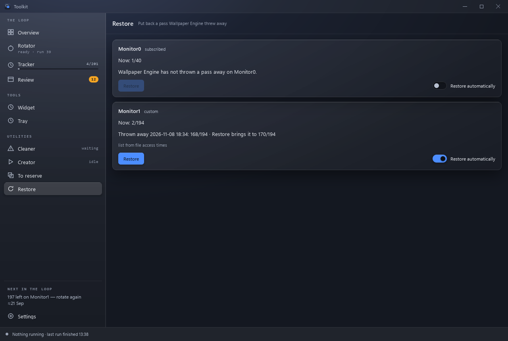

# Restore

Wallpaper Engine starts a monitor's playlist over whenever the playlist is
applied to that monitor again — when the monitor is attached after Wallpaper
Engine started (a slow screen at logon), or when the playlist is saved in
Wallpaper Engine. Everything already shown in the pass then comes round again.
**Utilities → Restore** puts that pass back.

Each tracked monitor has a panel:

- **Now** — where the pass Wallpaper Engine began after the reset stands.
- **Thrown away** — when Wallpaper Engine threw the old pass away, how far it
  had got, and what **Restore** brings it to: the old pass plus whatever has
  been shown since. Below it, where the list of shown wallpapers comes from —
  *saved by the tracker* (every reset from this version on), or *from file
  access times* for a reset recorded before (the files read while the pass
  ran).
- **Restore** — closes Wallpaper Engine, writes the rest of the pass as that
  monitor's queue in `bin\playliststate.bin`, and starts Wallpaper Engine
  again; it carries on from there. The other monitors are left as they were.
  The Tracker counts the pass from its old start.
- **Restore automatically** — the tray does the same unasked, a minute after
  it sees the reset (Wallpaper Engine is busiest in its first half minute),
  with a notification saying how it went. It is on for the monitor that shows
  the Rotator's playlist and off for the others until you switch it.

When a pass cannot be restored, the panel says why: Wallpaper Engine has not
thrown one away there, it was already restored, the playlist was renamed or
changed since (fewer than 90% of the shown wallpapers are still in it), or the
pass had already been shown to the end. A pass the Rotator began is never
offered: that start over was meant.

A monitor restored unasked is not restored unasked again for ten minutes, so a
screen that keeps dropping out cannot start a loop; the button still works.

Before rewriting, the old `playliststate.bin` is copied to
`pass-restore\playliststate.bin` in the data folder. If Wallpaper Engine does
not close, nothing is changed; if it does not start again, the message says so
— start it by hand.
